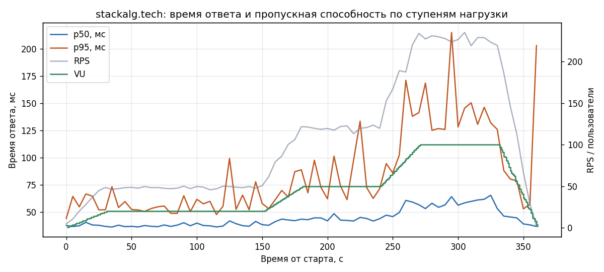

# Нагрузочное тестирование публичной части stackalg.tech

| | |
|---|---|
| Дата проведения | 31.10.2026 |
| Объект | Продакшен-развёртывание Account This, https://stackalg.tech |
| Версия фронтенда | сборка `index-CAl1QtC_.js` (от 26.10.2026) |
| Инструмент | Grafana k6 1.3.0 (Docker-образ `grafana/k6:1.3.0`) |
| Сценарий и скрипты | [`loadtest/load.js`](../loadtest/load.js), [`loadtest/analyze.py`](../loadtest/analyze.py) |
| Сырые результаты | [`loadtest/results/`](../loadtest/results/) |
| Итог | 38 842 запроса, все ответы соответствовали ожиданиям сценария |

## 1. Цель

Измерить время ответа и число запросов в секунду при загрузке сайта, получении публичного ключа и обращении к реестру без авторизации. Нагрузка возрастала от 20 до 100 виртуальных пользователей.

## 2. Объект тестирования

Цепочка обработки запроса на сервере (`docker-compose.prod.yml`):

1. **Caddy 2** — TLS (Let's Encrypt), HTTP/2 и HTTP/3, сжатие zstd/gzip;
2. **nginx** — статика фронтенда (React-PWA) и проксирование `/api/` на backend;
3. **backend** — ASP.NET Core (Kestrel), PostgreSQL и RabbitMQ во внутренней сети compose.

Сценарий воспроизводит открытие сайта до входа в учётную запись. В таблице перечислены запросы и ожидаемые ответы.

| Запрос | Что нагружает | Ожидаемый ответ |
|---|---|---|
| `GET /` | Caddy + nginx, `index.html` (907 Б) | 200 |
| `GET /assets/index-*.css` | статика nginx (1,2 КБ) | 200 |
| `GET /assets/index-*.js` | статика nginx, основной бандл (850 КБ, 275 КБ в gzip) | 200 |
| `GET /api/auth/server-key` | полный путь до backend, публичный эндпоинт | 200, JSON с ключом |
| `GET /api/tools` без токена | backend: конвейер аутентификации JWT | 401 |

## 3. Средства и окружение

- **Генератор нагрузки:** один компьютер разработчика (Windows 10, Docker Desktop), домашний интернет-канал,
  k6 в контейнере. Минимальное время ответа (31 мс) — это сетевая задержка до сервера с TLS-рукопожатием.
- **Сервер:** VPS с продакшен-конфигурацией. Время ответа измерялось на стороне клиента k6.

## 4. Методика

### 4.1. Сценарий виртуального пользователя (VU)

Одна итерация моделирует открытие приложения в браузере:

1. загрузить `index.html` и взять из него имена бандлов (они меняются при каждой сборке);
2. загрузить CSS; JS-бандл загружают 10 % итераций — «новые» посетители, у остальных он уже в кэше браузера;
3. запросить `/api/auth/server-key` и `/api/tools` без токена;
4. «подумать» 1–2 с (случайная пауза) и повторить.

Все запросы шлют `Accept-Encoding: gzip, deflate, br, zstd`, как браузер (см. п. 6.2).

### 4.2. Профиль нагрузки (ступенчатый)

| Участок | Длительность | Пользователей (VU) |
|---|---|---|
| Разгон | 30 с | 0 → 20 |
| **Ступень 1** | 2 мин | 20 |
| Разгон | 30 с | 20 → 50 |
| **Ступень 2** | 1 мин | 50 |
| Разгон | 30 с | 50 → 100 |
| **Ступень 3** | 1 мин | 100 |
| Спад | 30 с | 100 → 0 |

Итого 6 минут. Перед основным прогоном выполнен смоук-тест (1 VU, 30 с), чтобы проверить сценарий.

### 4.3. Критерии приёмки (пороги k6)

| Критерий | Порог |
|---|---|
| Доля неуспешных запросов | < 1 % (при превышении тест прерывается) |
| Время ответа, 95-й перцентиль, все запросы | < 500 мс |
| Время ответа, 99-й перцентиль, все запросы | < 1000 мс |
| `/api/auth/server-key`, 95-й перцентиль | < 300 мс |
| Успешные проверки содержимого (`check`) | > 99 % |

## 5. Результаты

### 5.1. Сводка (прогон 2, основной)

| Показатель | Значение | Порог | Результат |
|---|---|---|---|
| Всего запросов | 38 842 (9 469 итераций) | — | |
| Средняя пропускная способность | 107 запросов/с | — | |
| Средняя пропускная способность на ступени 100 VU | 228 запросов/с | — | |
| Ошибок | 0 (0,00 %) | < 1 % | ✅ |
| Время ответа: среднее / медиана | 60 / 47 мс | — | |
| Время ответа: p95 | 120 мс | < 500 мс | ✅ |
| Время ответа: p99 | 271 мс | < 1000 мс | ✅ |
| Время ответа: максимум | 1068 мс | — | |
| `server-key`: p95 | 108 мс | < 300 мс | ✅ |
| Проверки содержимого | 100 % | > 99 % | ✅ |
| Получено данных | 285 МБ | — | |

### 5.2. По ступеням нагрузки

Учтены только «полки» ступеней, без участков разгона.

| Ступень | Запросов | RPS | Ошибки | Среднее, мс | p50 | p95 | p99 | max |
|---|---|---|---|---|---|---|---|---|
| 20 VU | 5 803 | 48,4 | 0 % | 44 | 38 | 58 | 212 | 660 |
| 50 VU | 7 206 | 120,1 | 0 % | 52 | 44 | 83 | 241 | 750 |
| 100 VU | 13 683 | 228,1 | 0 % | 73 | 59 | 142 | 317 | 826 |

### 5.3. По запросам (весь прогон)

| Запрос | Запросов | Ошибки | p50, мс | p95 | p99 | max |
|---|---|---|---|---|---|---|
| `GET /` | 9 469 | 0 % | 44 | 102 | 147 | 319 |
| CSS | 9 469 | 0 % | 45 | 97 | 141 | 470 |
| JS-бандл (275 КБ gzip) | 966 | 0 % | 251 | 439 | 592 | 1068 |
| `/api/auth/server-key` | 9 469 | 0 % | 49 | 108 | 153 | 333 |
| `/api/tools` (401) | 9 469 | 0 % | 47 | 101 | 141 | 307 |

### 5.4. Динамика



## 6. Анализ

### 6.1. Масштабирование

На ступенях 20, 50 и 100 виртуальных пользователей сервер обработал в среднем 48,4, 120,1 и 228,1 запроса/с соответственно. На тех же ступенях p95 составил 58, 83 и 142 мс. Порог сценария — 500 мс.

### 6.2. Контрольный прогон без сжатия

Первый прогон выполнен без заголовка `Accept-Encoding`: k6 по умолчанию сжатие не запрашивает, и JS-бандл
передавался несжатым (850 КБ). Сценарий получился жёстче реального браузера, но критерии тоже выполнены:

| Показатель | Прогон 1 (без сжатия) | Прогон 2 (gzip) |
|---|---|---|
| Запросов / ошибок | 36 677 / 0 | 38 842 / 0 |
| Получено данных | 857 МБ | 285 МБ |
| p50 / p95 / p99, мс | 52 / 199 / 593 | 47 / 120 / 271 |
| p95 на ступени 100 VU, мс | 270 | 142 |
| JS-бандл, p95, мс | 1740 | 439 |
| Максимум, мс | 3344 | 1068 |

Разница почти целиком приходится на передачу бандла, то есть на ширину канала. Сжатие в Caddy (`encode zstd gzip`)
работает и сокращает трафик в 3 раза.

## 7. Выводы

За минуту на ступени 100 виртуальных пользователей сервер обработал 13 683 запроса. Для 95 % запросов время ответа составило до 142 мс. За весь шестиминутный прогон выполнено 38 842 запроса. В это число входят 9 469 обращений к реестру без токена, для которых ожидаемым ответом был HTTP 401.

## 8. Как повторить

Из корня репозитория (cmd), нужен Docker:

```bat
docker run --rm -v "%cd%/loadtest:/scripts" -e SMOKE=1 -e RUN=smoke grafana/k6:1.3.0 run /scripts/load.js
docker run --rm -v "%cd%/loadtest:/scripts" -e RUN=run3 grafana/k6:1.3.0 run --out csv=/scripts/results/run3/raw.csv.gz /scripts/load.js
python loadtest/analyze.py run3
```

Папку `loadtest/results/<прогон>` нужно создать заранее. `analyze.py` печатает таблицы по ступеням и запросам и
сохраняет график `timeline.png` (нужен `matplotlib`). Адрес меняется переменной `BASE_URL`.
